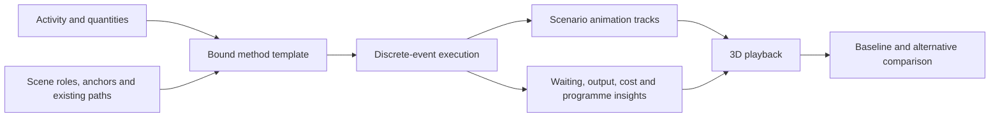

# Prosota Planner: visual construction simulation

Research and implementation map — 30 October 2026.

**Status: first worker/tool method implemented in Preview.17; working-sequence
promotion and video delivery added in Preview.18. Later stages remain planned.**
Walk → work with tool → continue now binds placed assets and an existing
route, supports grip fitting and reusable device templates, and plays the solver's
events in the viewport. Fleet methods and synchronised scenario comparison are
not included in this delivery. Promotion fits each activity's complete sequence
proportionally to its parent dates, with a Simple 4D toggle and combined video
export. Saved operational calculations remain unchanged. See SIMULATOR_GUIDE.md
for the available workflow.

The research below combines the initial repository audit with Reallusion's public
product pages and manuals. It does not claim a hands-on test of iClone or its videos.

## Product direction

Build on Prosota's existing activities, steps, resources, paths, timed stops,
workers, equipment controls, attachments and element states. The next substantial
addition is the connection between these systems: a reusable method that can be
calculated, played in 3D, inspected and compared with another method.

The owner's clarification is decisive: authored paths are sufficient for the
first delivery. Pedestrians can follow pavements, cars can follow roads with
curved bends and stops, and workers and plant can follow routes inside the site.
Automatic driving, road-network generation and autonomous navigation are outside
this core scope.

A user should be able to say, through visual controls:

> Use these workers and this equipment, in these areas, following these routes,
> to perform this method. Show the work, explain the delays, and let me compare
> a different arrangement without changing my approved programme.

The scene is the working surface. The schedule supplies context and constraints.
The simulation supplies events. Animation makes those events visible. Reports
explain the same execution rather than describing a separate, disconnected model.

## What to take from iClone

The useful patterns are scene-bound actions, conditions and reuse. Prosota should
translate them into construction terms, with project quantities, resource
reservations and programme consequences attached to them.

| Studied pattern | Prosota application | Proposed default interaction |
| --- | --- | --- |
| Planning sets combine scene objects with behaviour and allow actor replacement. | A method template contains roles and behaviour; an instance binds them to this project's workers, machines and locations. | Choose a template card, then fill its illustrated role slots. |
| Action lists queue motions for an actor. | Walk, prepare, work, stop and continue become visible steps associated with one activity. | A step strip beside the scene, with a preview button on each action. |
| Go To separates travel from the action at the destination. | Follow an existing path to a marked route position; then perform work. | Pick the path and click the work marker. |
| Interactive props have calibrated entrance, reach and look-at points. | Tools and machines have saved grip, working, seat and load anchors. | Align once with the viewport gizmo; preview the complete motion; save the setup. |
| Portable interactions distinguish pickup, carrying and placement. | A beam, pallet or tool changes state and attachment while retaining its identity. | Pick source, carrier anchor and destination in the scene. |
| Position, occupancy and zone conditions determine the next action. | Wait for a truck, a free loading bay, a finished task or available material. | Choose a named condition, with its target highlighted in the scene. |
| Parallel execution and grouped subgraphs compose larger behaviour. | A crew works concurrently; a load–haul–tip method contains reusable smaller actions. | Duplicate or group step cards; offer a graph view for advanced editing. |
| Sets can be connected at their interaction points. | Delivery hands material to a laydown process; a crane method consumes that material. | Connect a named output, such as “beam delivered”, to the next method. |
| In-scene information and logs expose execution state. | Show “waiting for Truck 2” over the relevant machine and link it to the causal event. | Click a wait label or result to focus and replay that moment. |

Sources for the patterns above: [planning sets](https://manual.reallusion.com/Motion-Planning/Content/ENU/1.0/02-Quick-Guide/Quick-Guide-for-Using-Motion-Planning-Sets.htm),
[action lists](https://manual.reallusion.com/iClone-8/Content/ENU/8.5/50-Animation/MD-Runtime/Queuing-Motions-in-Action-List.htm),
[Go To](https://manual.reallusion.com/Motion-Planning/Content/ENU/1.0/04-Flexible-Editing-Nodes/Using-Go-To-Nodes.htm),
[prop interaction and calibration](https://www.reallusion.com/iclone/sims-builder.html),
[portable actions](https://manual.reallusion.com/Motion-Planning/Content/ENU/1.0/04-Flexible-Editing-Nodes/Using-T4-Nodes.htm),
[placement occupancy](https://manual.reallusion.com/Motion-Planning/Content/ENU/1.0/04-Flexible-Editing-Nodes/Using-Check-Placement-Point-Nodes.htm),
[zone conditions](https://manual.reallusion.com/Motion-Planning/Content/ENU/1.0/04-Flexible-Editing-Nodes/Using-Check-Zone-Nodes.htm),
[parallel nodes](https://manual.reallusion.com/Motion-Planning/Content/ENU/1.0/04-Flexible-Editing-Nodes/Using-Parallel-Nodes.htm),
[subgraphs](https://manual.reallusion.com/Motion-Planning/Content/ENU/1.0/04-Flexible-Editing-Nodes/Integrating-Nodes-to-Sub-Graphs.htm),
[connecting sets](https://manual.reallusion.com/Motion-Planning/Content/ENU/1.0/02-Quick-Guide/Connecting-MP-Sets.htm)
and [scene/log outputs](https://manual.reallusion.com/Motion-Planning/Content/ENU/1.0/04-Flexible-Editing-Nodes/Using-Print-Nodes.htm).

Two distinctions matter. First, importing a compatible body motion is not the same
as creating a calibrated tool interaction: the grip, approach and release still
need an authored setup. Second, a behaviour set is more than an animated FBX; an
FBX import should not imply that iClone's planning logic has been imported.
Reallusion documents saving complete sets separately as `.iPlanningSet` files.
[Set persistence](https://manual.reallusion.com/Motion-Planning/Content/ENU/1.0/04-Flexible-Editing-Nodes/Saving-Loading-MP-Sets.htm).

Random actions and shift variations are useful later, but construction comparisons
need explicit assumptions and reproducible runs. Introduce seeded variation only
after deterministic methods work. A single stochastic run must not be presented
as a reliable productivity forecast.

## Initial audit: foundations and gaps

| Foundation inspected | Reuse | Gap to close |
| --- | --- | --- |
| `fourD/pathCurve.ts`, `sitePathMotion.ts`, `PathsPanel.tsx` | Mixed straight/curved paths, coordinate locks, route-progress keys, stops, reverse travel, heading and clip pacing. | Bind event-driven travel phases to these paths and markers. Use the same curve length for calculation and playback. |
| `fourD/workerActions.ts`, `WorkerActionsPanel.tsx` | Timed clips, looping, blending and a route-stop helper. | Bundle related timings into one method so edits cannot leave work, attachment and departure out of sync. |
| `fourD/SiteAttachments.tsx`, `attachmentTransform.ts` | Animated anchors and editable grip offsets, saved on the object. | Save reusable calibrated interactions, validate replacements and preview entry/work/exit together. |
| `fourD/equipmentRig.ts`, `EquipmentPlayback.tsx` | Named controls, keys, hierarchy, mechanical followers and flexible parts. | Map semantic actions such as lift or tip to a validated control recipe for each machine. |
| `fourD/equipmentCycle.ts`, `soilSimulation.ts`, `soilPlayback.ts` | Pickup/carry/tip poses and visual material movement. | Connect cycle events to quantity accounting and receiving containers; do not infer capacity from an attractive animation. |
| `backend/app/services/operation_simulation.py` | Discrete events, calendars, dependencies, capacity, held resources, repeated phases, disruption and waiting reasons. | Expose durable physical resource-unit identity and spatial reservations to playback. |
| `simulator/SimulationPlayback.tsx` | Actual IFC/imported elements can change handling state, follow a carrier and return to their original scene state on exit. | Current playback primarily consumes explicit `object_states`; it does not choreograph all workers and machines from resource events. |
| `simulator/types.ts`, scenario services and `SIMULATOR_GUIDE.md` | Saved alternatives, stale-result detection, programme impact and explicit acceptance. | Add visual bindings, versioned templates, execution tracks and synchronised scenario replay. |

Important details from the current implementation:

- The solver already assigns internal resource-slot indices. The missing piece is
  stable scene-unit identity in the saved model and emitted events, not inventing
  resource allocation from scratch. Current events expose resource counts.
- The scene path sampler uses the actual curve and its arc length. Current solver
  route timing uses the supplied straight-segment length; curved-route calculation
  and scene movement must share one measured route representation.
- A worker action's route-stop helper shifts later route keys, but does not retime
  all other work actions, equipment keys and soil settings. Template-generated
  timing must own these dependencies together.
- Current clip sampling converts project dates through the timeline's days-per-
  second setting. Operational simulation requires an explicit clock bridge so
  changing viewing speed does not change the simulated action itself.
- A queued task is not necessarily a truck physically parked at a loading bay.
  Do not turn every pending cycle into a visible vehicle or call task backlog a
  spatial queue.
- Existing space/resource capacity is not collision detection. Drawn routes and
  reserved zones can coordinate traffic without claiming autonomous avoidance.

## The user workflow

1. **Choose the work.** Select an activity and choose a method template. Show a
   short visual preview and the required roles before adding it.
2. **Assign the scene.** Pick placed workers, machines, tools and actual elements.
   Place work, waiting, pickup and destination markers directly in the viewport.
   Bind existing paths. A resource count must correspond to explicit scene units
   or a deliberately labelled schematic representation.
3. **Arrange the steps.** Use a compact sequence such as `Arrive → Wait → Load →
   Travel → Tip → Return`. Selecting a card highlights its objects and anchors.
   Common edits are time, quantity, destination and “what must be ready”.
4. **Check and preview.** Preview a single interaction in place. Show missing
   motion, grip or destination issues beside the affected card, with a direct
   action to fix them. Do not silently substitute an unrelated motion.
5. **Run and watch.** Calculate the events, then play the corresponding scene.
   Highlight the active step. Show short state labels only when useful: working,
   travelling, waiting, blocked or finished.
6. **Inspect a cause.** Click a wait or conflict to jump to that moment and see the
   resource, predecessor or occupied area responsible. Show the consequence in
   elapsed time, output and programme impact alongside it.
7. **Try an alternative.** Duplicate the baseline, change one or more inputs,
   rerun and compare. Apply programme changes only through the existing review.

The scene stays visible throughout. Use a dock for the current method and a compact
timeline for playback. Keep the full results table available as a secondary view.
An advanced graph should edit the same method definition as the step strip; it
must not become a second, divergent workflow that users have to maintain.

### Time stops versus event waits

“Stop here for 10 seconds” remains an ordinary timed path stop. “Wait here until
the loading bay is free” is a condition whose duration the simulation determines.
Both result in a stationary vehicle in the scene, but only the second responds
correctly when the fleet or method changes.

Use direct labels: **Wait for duration**, **Wait for resource**, **Wait for arrival**,
**Wait for completion**, and **Wait for free space**. The target is selected in the
scene or from a short list of method roles. Reallusion similarly distinguishes a
duration-based Wait node from condition-based flow; Prosota should expose that
distinction without requiring users to wire polling loops.
[Wait node](https://manual.reallusion.com/Motion-Planning/Content/ENU/1.0/04-Flexible-Editing-Nodes/Using-Wait-Nodes.htm).

Ordinary cars and pedestrians may use an ambient path template with authored
pauses and repeated travel. They affect productivity only if the user explicitly
connects them to a crossing, access gate or shared-space rule. Merely placing a
car near a truck must not silently add a calculated delay.

## Reusable templates

Use two main concepts in the interface:

**Action** — one reusable interaction, such as use jackhammer, lift a beam,
tip a truck, wait or follow a route. An action contains suitable clips/control
poses, named anchors, timing markers, attachment changes and valid end states.

**Method template** — a sequence or parallel arrangement of actions, with roles,
resource demands, conditions, repetitions and outputs. Each project instance
binds those roles to its own assets, paths, locations and activity.

An optional saved scene layout can include markers and relative placements. It
should be possible to reuse the method without copying a previous site's
coordinates, IFC IDs, activity assignments or absolute dates.

| First templates | Visible execution | Inputs that users should change |
| --- | --- | --- |
| Walk, use tool, continue | Walk to a work point, align, use the tool, stop and leave. | Worker, compatible work clip, tool/grip, path, point and work duration/quantity. |
| Excavate, load, haul and tip | Plant works; the assigned truck waits, loads, travels, tips and returns. | Fleet, loading/receiving areas, route legs, capacities, cycle recipe and rates. |
| Deliver and install an element | The actual beam/panel moves from truck to laydown or lifting gear, then reaches its design position. | Element identity, carrier, source/destination, lift anchors and installation rule. |
| Forklift transfer | Approach, lift a load, carry, place, lower and withdraw. | Forklift, load, pickup/drop markers, path, lift height and handling timings. |
| Site circulation | Cars, pedestrians or idle plant follow authored routes and stops. | Asset set, spacing/start offsets, routes, pauses and repeat policy. |

For a jackhammer setup, a user should calibrate the grip once, test the full work
motion and save it. Selecting that setup later should populate its linked action,
attachment and route pause. A different tool shape or worker proportion may need
an adjustment preview; “compatible skeleton” alone does not guarantee hand contact.
Do not require general two-hand IK for the first usable release.

Template versions and asset bindings must be recorded. Duplicating a template
creates an independent editable instance. Updating a library template must offer
a reviewed update rather than overwriting a tuned project setup.

## Execution architecture

Keep one execution record as the source of truth. Each event needs stable IDs for
the scenario run, method instance, cycle, step/action and physical resource units;
its time interval, progress and state; related element/load identities; and a
structured cause when it waits or fails. Existing names remain display labels.

The playback compiler converts that record into route progress, worker clips,
equipment control tracks, attachment intervals and element/material states.
Use the existing samplers and renderers. This is the connecting layer, not a new
animation engine.

### Rules the implementation must preserve

- **One physical unit cannot do two jobs at once.** Reserve the assigned truck
  through its cycle; release the excavator after loading if the method allows it.
  Keep stable identity across travel, work, waiting and return events.
- **Arrival precedes work.** Travel duration comes from a shared path-length and
  speed model or explicit authored timings. Choose one timing authority per leg;
  do not add authored dwell time twice. Multiple legs can use different existing
  paths, joined by explicit handoff markers with continuity checks.
- **Visible queues have locations.** Assign waiting slots or route-progress
  markers with capacity and an explicit ordering rule. If a queue has no space,
  report it; do not stack vehicles at the same point or invent a parking layout.
- **Generated timing is separate.** Scenario playback uses temporary or saved
  scenario tracks, preserving the user's original path and rig keys. Exiting
  restores the original scene; accepting a method is a separate operation.
- **Transform ownership is explicit.** A simulator-controlled vehicle follows its
  scenario route; its rig controls move parts; the operator follows the cab; a
  held load follows its attachment. Detect ownership conflicts and cycles rather
  than letting path, profile and attachment updates fight each frame.
- **Operational time is stable.** Store simulated seconds/dates independently of
  playback speed. Date, Seconds and Frames are views of the same execution. Faster
  playback changes viewing rate, not the computed travel, production or clip pace.
  For a long programme, let users inspect a chosen cycle in detail; any compressed
  representative view must be labelled as such.
- **Seeking is deterministic.** A jump to a time must reconstruct routes, held
  objects, material quantities and poses without requiring playback from zero.
  Seed any random choices and cache material checkpoints where necessary.
- **Objects keep identity.** IFC GlobalIds and imported-part identities survive
  delivered, carried, placed and installed states. Temporary handling overrides
  the normal appearance profile only during the owned interval.
- **Interruptions have defined behaviour.** Choose finish current action, pause
  and resume, restart, or an authored recovery. Do not drop an attached beam or
  teleport a truck when a shift ends. iClone's own interruption behaviour also
  distinguishes interruptible actions; Prosota needs construction-specific rules.
  [Interruption rules](https://manual.reallusion.com/Motion-Planning/Content/ENU/1.0/04-Flexible-Editing-Nodes/Condition-Nodes-and-Animation-Interruption.htm).
- **Quantity and appearance agree.** Loading changes source, carried and deposited
  quantities through one ledger. Soil/gravel/rock appearance can differ without
  inventing different production rates. Where geometry is illustrative, label it.
- **Missing requirements stay visible.** A calculation may be available while a
  visual binding is incomplete. Show exactly what is missing; never announce a
  completed visual sequence when only numerical results were generated.

## Scenario comparison and insight

Save the baseline definition, scene bindings, asset/template versions and event
result. Duplicate it to test an alternative. Both should be replayable from their
recorded results rather than recalculated differently every time they are opened.

Offer two explicit comparison modes:

- **Same elapsed time:** where is each scenario after the same amount of time?
- **Same completed quantity:** how long and how many resources did each need to
  reach the same output?

Use the same camera, with either an A/B switch or side-by-side views when space
and rendering budget allow. The initial implementation can use A/B switching to
avoid doubling the cost of a heavy 3D scene. Do not overlay duplicate opaque
machines in one scene and make users decipher them.

The useful outputs are contextual: completed quantity, elapsed time, working and
waiting time, resource use, unresolved spatial conflicts and programme effect.
Costs must state their basis; current productive-unit-hour costs do not include
all idle hire charges. Clicking a result should show its contributing events.

For example, “Truck 2 waited for the loading bay while Truck 1 was loading” should
open that interval with both trucks and the bay visible. A faster alternative
should be explainable by the changed resource, route or method, not merely a
green percentage. Adding trucks may stop helping once loading capacity is the
constraint; the scene should make that bottleneck apparent.

## Delivery order and acceptance gates

### 1. One complete reusable worker/tool method

Deliver the template structure, scene role binding, readiness checks and event-to-
animation bridge through **walk → work with jackhammer → continue**. Start with
the actual supplied male/female workers and work/idle/walk clips.

Pass when the user can create it, adjust the grip with the gizmo, save, close,
reload, change the work duration and reuse it on another route without manually
repairing several timelines. Scrubbing backwards, changing display units and
changing viewing speed must preserve the same physical sequence. An incompatible
replacement must produce a useful action, not broken motion or extra parts cards.

### 2. One complete resource-driven fleet method

Extend the same system to **load → haul → tip → return**, using validated equipment
recipes and existing paths. Introduce stable scene-unit allocation, queue slots,
bay reservations, repeated cycles and the shared quantity ledger.

Pass with one loader and several distinct trucks: no double booking, waiting
trucks occupy actual slots, loading starts after arrival, tipping empties the
assigned load, and changing truck count changes both events and playback.
Calendar interruptions and constrained receiving capacity must be tested too.

### 3. Actual element handoffs and visual alternatives

Use the existing element-state system for truck → laydown → crane → installed
beam/panel, and provide synchronised baseline/alternative replay with causal
inspection. Test direct placement as well as a laydown handoff.

Pass when the same element is visibly carried once, never duplicated or claimed
by two carriers, finishes at its design placement, and restores on scenario exit.
Comparisons must use the same output basis and preserve the approved programme
until the user accepts the reviewed changes.

### 4. Broaden the library and advanced composition

Add forklift transfer, tool stations, circulation, crew allocation, material
types, parallel work and reusable submethods. Introduce the optional graph view
only after the simple cards have proven their data model. Later add controlled
variation, shift reassignment and disruption/recovery templates.

Do not make automatic driving, full collision physics, general IK, fluid or
granular mechanics prerequisites. Authored paths and tested actions can deliver
the central value. These remain visual and operational planning simulations;
mechanical limits, clearance validation and engineering calculations must be
identified separately where supplied.

## Validation and definition of done

For each delivery, verify the solver, playback compiler and actual rendered
scene together using the supplied assets. Numerical tests alone will not catch
detached rig parts, wrong tool contact, duplicated objects or overwritten poses.

Required coverage includes save/reopen, panel changes, undo, template duplication,
asset replacement, backwards seeking, incomplete bindings, route edits, schedule
changes and deterministic replay at different frame rates. Changing a bound
asset, path or template invalidates the relevant cached result with a clear reason.

Do not bake a key for every frame by default. Reuse geometry and motion data;
compile compact event intervals and sample visible actors. Measure realistic
scene performance and introduce detail controls against that evidence.

The first milestone is complete only when a user can watch, change and reuse one
whole method without repairing disconnected settings. That is the foundation for
the larger construction simulator, and the criterion for expanding its library.
